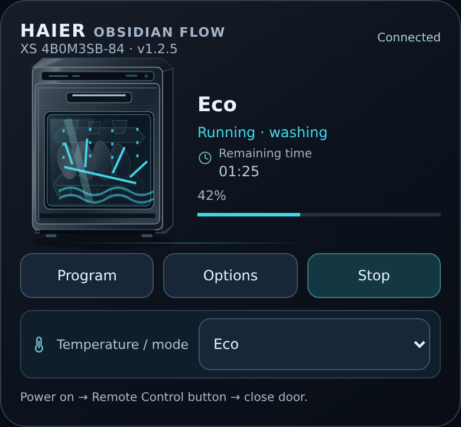

# Haier Obsidian Flow

An unofficial community dashboard card for the **Haier XS 4B0M3SB-84** dishwasher in Home Assistant. Not affiliated with, supported by, or endorsed by Haier or Home Assistant.



## Features

- Graphite 3D SVG appliance, enlarged to 125%, with state-driven wash, hot-rinse/dry and folding-door animations.
- Tap plates for a shimmer; tap or hold the appliance body for a decorative optical rinse. These artwork interactions make **no service calls**. Enter/Space also activate the decorative rinse.
- Start/Stop with stop confirmation, program selection and options: Extra Dry, Tablet, Auto Door Open and optional 3-in-1.
- Home Assistant temperature/mode select and an exact remaining-time label, with no invented countdown.
- Polish, German and English; reduced-motion support and animation cleanup on blur, disconnect and hidden tabs.
- Self-contained JavaScript and SVG: no runtime network dependencies or external artwork.

## Requirements and limitations

Requires Home Assistant with an existing hOn integration that exposes the matching dishwasher entities and services. This card does not install an integration, authenticate to hOn, or discover appliances. The supported baseline is **XS 4B0M3SB-84**; compatibility with other models has not been established. Check every entity ID in Developer Tools → States before using controls.

The default `select.xs_4b0m3sb_84_temperatur` is a **configured selection**, not an actual temperature sensor. The remaining-time default is also a select: its live countdown semantics have **not been independently proven**. The card displays HA's exact state (and an explicitly supplied unit for numeric states); it does not count down or substitute another sensor.

State animations are illustrative, not proof of water flow, heat, safe door operation or successful appliance execution. Start requires connection, an available start switch and a closed-door state; remote operation also depends on the appliance and integration. Follow the manufacturer's instructions, enable Remote Control when required, and verify the appliance physically before remote operation. Options and temperature changes send real HA service calls.

## Manual installation

1. Download `haier-dishwasher-neo-card.js` from [release v1.2.5](https://github.com/lovicub/haier-dishwasher-neo-card/releases/tag/v1.2.5).
2. Put it in `config/www/community/haier-dishwasher-neo-card/` in your HA configuration directory.
3. Add a dashboard resource of type **JavaScript Module**:
   `/local/community/haier-dishwasher-neo-card/haier-dishwasher-neo-card.js?v=1.2.5`.
4. Add a Manual card using the YAML below. After manual upgrades, change the query version and hard-refresh the browser or clear the frontend cache. Remove duplicate resources.

## HACS custom repository

The layout follows the [official HACS dashboard requirements](https://www.hacs.xyz/docs/publish/plugin/): the root JS matches the repository basename and the release carries the same single JS file. This is a custom repository, not an official HACS default listing. Check the [Validate workflow](https://github.com/lovicub/haier-dishwasher-neo-card/actions/workflows/validate.yml) for the current validation result before installing.

After validation passes, open HACS → menu → Custom repositories, add `https://github.com/lovicub/haier-dishwasher-neo-card`, choose **Dashboard**, then download Haier Obsidian Flow. Check that the resource is registered as a JavaScript Module at `/hacsfiles/haier-dishwasher-neo-card/haier-dishwasher-neo-card.js`. Add it if your setup does not register it automatically. Use either the HACS resource or the manual resource once.

## Card configuration

```yaml
type: custom:haier-dishwasher-neo-card
language: en
remaining: select.xs_4b0m3sb_84_verbleibende_zeit
temperature: select.xs_4b0m3sb_84_temperatur
program: select.xs_4b0m3sb_84_programm
start: switch.xs_4b0m3sb_84_geschirrspulmaschine
door: binary_sensor.xs_4b0m3sb_84_tur_offen
connection: binary_sensor.xs_4b0m3sb_84_gerateverbindung
extra_dry: switch.xs_4b0m3sb_84_extra_trocken
tablet: switch.xs_4b0m3sb_84_tab_status
auto_door: switch.xs_4b0m3sb_84_tur_offen
three_in_one: switch.xs_4b0m3sb_84_3_in_1
```

These are the actual source defaults. They identify the product model, not credentials. Override them with your own matching entities; `door` is a binary sensor while `auto_door` is a separate switch. `language` accepts `en`, `de`, `pl`; omitted, it follows HA and falls back to English.

Optional source-supported keys `status`, `phase` and `progress` accept entity IDs. Without explicit IDs, the card uses a uniquely matching sensor under the built-in model prefix: machine-status, phase and progress name patterns respectively. For other prefixes, configure these IDs explicitly. Progress appears only for a finite 0–100 value with unit `%`. Phase keywords determine wash/dry visuals; missing or ambiguous sensors cannot establish the actual cycle phase. There is no graphical configuration editor.

## Troubleshooting

- **Custom element not found:** check the module resource URL, ensure the JS loads successfully, remove duplicate resources and refresh the cache.
- **Unavailable/disabled controls:** verify entity domains, states, option lists and integration availability. Temperature needs at least two options and a writable select.
- **Start does nothing:** check connection, closed-door state, appliance power and Remote Control. A successful HA call does not guarantee execution by the appliance. Stop opens a confirmation first.
- **No progress/time or unexpected label:** inspect the configured entity itself. The card intentionally does not infer a timer or temperature from program names.
- **No animation:** check start/door/phase states and reduced-motion settings. Decorative rinse is suppressed during wash or when the door is open.
- **Report a problem:** include card version, browser, sanitized YAML and relevant entity states, removing tokens, personal names, addresses and private URLs.

## Release and maintenance

See [CHANGELOG](CHANGELOG.md). v1.2.5 is the first public release, preserving the working card byte for byte. SHA256:

```text
0cd297f4ccb75dd7fe5c76e7145261061d0688b4a26d6e68b8f92d55a203abae
```

Maintainers: after explicit owner approval, take the intended JS from the local `codex-exports` export directory, compare its hash with the approved deployed baseline, review every prospective file for privacy/licensing, run syntax and isolated browser fixtures, regenerate sanitized screenshots, and update the changelog. Commit only release-ready files to this standalone repository. Push an approved version tag and create a GitHub release attaching the matching JS; verify its downloaded hash. Local development or HA changes are **not** authorization to publish future releases. Publishing this project does not deploy or replace an HA resource. No experimental update loader is included.

## License and artwork

[MIT](LICENSE), copyright 2026 lovicub, for this project's code and source-derived screenshots. The inline appliance artwork is composed of SVG paths and gradients in the card source; no external photo, font, logo asset or library is bundled. Product and platform names identify compatibility; their trademarks remain with their respective owners.

Screenshots use fabricated entities in isolated Chromium with network requests blocked; they contain no live dashboard context. See [verification notes](docs/VERIFICATION.md).
